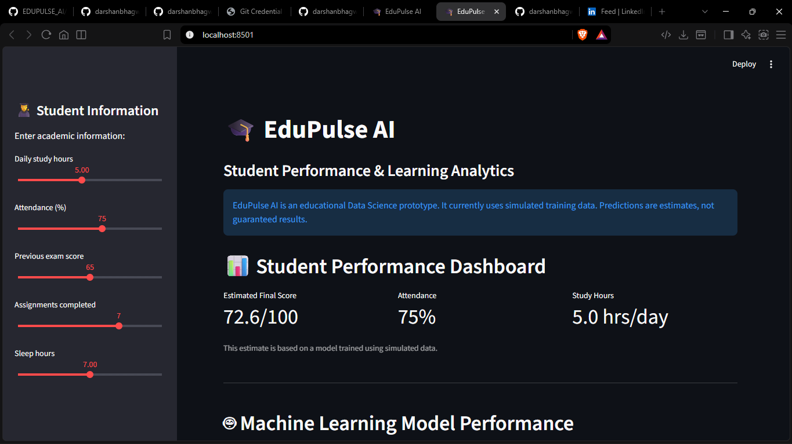
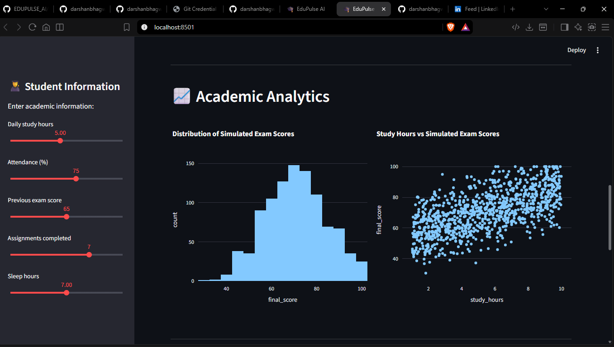
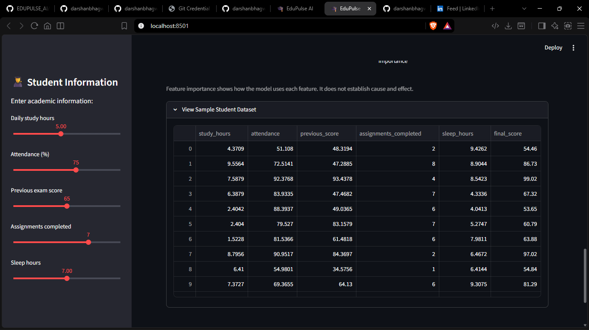
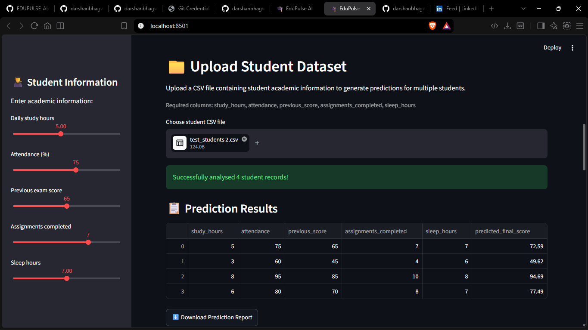

# 🎓 EduPulse AI
### Student Performance & Learning Analytics

EduPulse AI is a Machine Learning-based educational analytics prototype designed to explore student learning patterns and estimate academic performance.

It provides an interactive dashboard for individual predictions, batch CSV predictions, learning recommendations, and academic data visualization.

> **Note:** This prototype currently uses simulated student data. Its predictions are experimental estimates and are not validated for real-world academic decisions.

## 🚀 Features

- Individual student performance estimation
- Random Forest Regression model
- CSV-based batch predictions
- Personalized learning recommendations based on input values
- Academic performance visualizations
- Machine Learning performance metrics
- Feature importance analysis
- Downloadable prediction results

## 🛠️ Technologies Used

- Python
- Pandas
- NumPy
- Scikit-learn
- Streamlit
- Plotly
- Joblib

## 🧠 Machine Learning Model

**Algorithm:** Random Forest Regressor

The model uses five input features:

1. Study Hours
2. Attendance
3. Previous Score
4. Assignments Completed
5. Sleep Hours

### Model Evaluation

| Metric | Result |
|---|---:|
| Mean Absolute Error (MAE) | 4.63 |
| Root Mean Squared Error (RMSE) | 5.63 |
| R² Score | 0.818 |

Dataset:
- Total records: 1,000
- Training records: 800
- Testing records: 200

These metrics are based on a simulated dataset and should not be interpreted as real-world model accuracy.

## 📸 Project Screenshots

### 1. Main Dashboard


### 2. Model Performance


### 3. CSV Batch Prediction


### 4. Student Database


## 📂 Project Structure

```text
EDUPULSE_AI/
│
├── app.py
├── train_model.py
├── requirements.txt
├── README.md
├── .gitignore
│
├── data/
│   ├── student_data.csv
│   └── test_students.csv
│
└── models/
    ├── student_model.pkl
    └── model_metrics.json
```

## 💻 Installation and Setup

### 1. Clone the repository

```bash
git clone https://github.com/darshanbhagwat/EDUPULSE_AI.git
```

### 2. Open the project folder

```bash
cd EDUPULSE_AI
```

### 3. Create a virtual environment

```bash
python -m venv venv
```

### 4. Activate the environment (Windows PowerShell)

```powershell
.\venv\Scripts\Activate.ps1
```

### 5. Install dependencies

```bash
pip install -r requirements.txt
```

### 6. Train the Machine Learning model

```bash
python train_model.py
```

### 7. Run the application

```bash
streamlit run app.py
```

The dashboard will open in your browser.

## 🔮 Future Improvements

- Evaluate the model using suitable real-world datasets with appropriate permissions.
- Improve model validation and generalization.
- Add more explainable AI features.
- Improve learning recommendations.
- Explore additional Machine Learning algorithms.

## 👨‍💻 Developer

**Darshan Yogesh Bhagwat**

First-Year B.Sc. Data Science Student

Savitribai Phule Pune University, Department of Technology

GitHub: https://github.com/darshanbhagwat

LinkedIn: https://linkedin.com/in/darshan-bhagwat-891128431

---

⭐ Developed as an educational Data Science and Machine Learning prototype.
